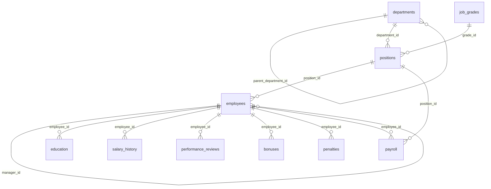

# Company sample: a Vietnamese software company

Synthetic HR and payroll data for a fictional company, Công ty Cổ phần Công nghệ Perry. It has about 100 employees in Hà Nội and TP. Hồ Chí Minh and 12 months of payroll for 2026. Upload it as Datasets to try the Analysis Agent on questions that join several tables. Every person in it is made up.

[`scripts/company_data.py`](../../scripts/company_data.py) generates it. The same arguments always give the same files, and a test checks that these files are what the defaults generate. After editing the script, regenerate them:

```powershell
uv run python -m scripts.company_data                     # rewrite these files
uv run python -m scripts.company_data --load              # ...and upload them as Datasets
uv run python -m scripts.company_data --employees 1000 --years 2 --out <folder>
```

Each table comes with its Data Dictionary (`payroll.dictionary.csv` beside `payroll.csv`): what one row is, what the less obvious columns mean, and the joins Perry can't infer from column names (`employees.manager_id` and `performance_reviews.reviewer_id` point at `employees.employee_id`, `departments.parent_department_id` at `departments.department_id`). The descriptions live in `DICTIONARY` in the script, which writes each dictionary from the columns it writes, so they can't drift apart. Follow the same pattern to describe a table of your own.

`--load` uses your `.env` database and works while Perry runs. You can also drop the files into **Datasets** yourself: all of them in one upload, or each CSV together with its `.dictionary.csv`. Each CSV becomes the Dataset of the same name (`payroll.csv` becomes `payroll`) and replaces any Dataset by that name; the dictionary describes it instead of becoming a Dataset. The order doesn't matter, nor does uploading a few at a time: a description of a Dataset not uploaded yet, or a join the dictionary declares to one, waits for it, and the upload reply says so.

Column names are English, values Vietnamese, money whole VND. Dates are ISO text (`2026-04-01`), and a month is `YYYY-MM`. Perry stores both as text, so cast with `::date` to do date arithmetic.

## Tables



**The organisation**

- `departments`: a tree. `Khối Kỹ thuật` holds the software and infrastructure departments, so the "engineering" totals sum over its children.
- `job_grades`: G1 (Fresher) to G7 (Giám đốc), each with a monthly salary band.
- `positions`: a title in a department at a grade, for example `Lập trình viên (Senior)`.

**People**

- `employees`: one row per person ever employed, including those who left during the year (`status`, `termination_date`). Their `position_id` is the latest held. `manager_id` points at another employee; only the Tổng Giám đốc has none.
- `education`: degrees and certificates, several per person.
- `salary_history`: every change of base salary or position, with its reason:
  - hiring
  - the probation rate (85%), then the full salary
  - the April review
  - promotion

**Monthly events**

- `performance_reviews`: the yearly review in January for the year before, and the mid-year review (`2026-H1`) in July. Ratings run from 1 to 5. The rating drives the April raise, the Tết bonus and July promotions.
- `bonuses`: four kinds, each with the `pay_period` it is paid in:
  - Tết bonus (February 2026): 0.5 to 2 months' salary by rating, pro rata for those who joined during the year.
  - Quarterly sales bonus.
  - Project bonus.
  - Referral bonus.
- `penalties`: disciplinary actions. Vietnamese labour law forbids fines (Bộ luật Lao động 2019, Article 127), so most rows carry no money:
  - `Khiển trách` (a reprimand).
  - `Kéo dài thời hạn nâng lương`, which also cancels an April raise due within the following six months.
  - `Bồi thường thiệt hại tài sản`: the only money taken, compensation for damaged property, capped at 30% of the month's salary (Article 129). It comes off the net pay.
- `payroll`: one row per employee per month worked. It is computed from the tables above and the rule tables below, so its columns agree with them.

**Rules** (a change in the law is a new row with a later `effective_from`, not a code change)

- `tax_brackets`: personal income tax. These are the 7 brackets in force until 2025, and the 5 brackets (5% to 35%) from the 2026 tax period under Luật Thuế TNCN 109/2025/QH15.
- `insurance_rates`: BHXH, BHYT and BHTN rates for employee and employer, and the salary cap each is paid on:
  - BHXH and BHYT: 20 × the base reference salary (lương cơ sở).
  - BHTN: 20 × the region I minimum wage.
- `payroll_parameters`: the other numbers payroll uses:
  - the personal deduction of 15.5 million and the dependent deduction of 6.2 million from 2026 (NQ 110/2025/UBTVQH15)
  - the base reference salary and minimum wage
  - the meal allowance and overtime rate
  - the probation rate and length

## How a payslip is computed

For one employee in one month (`payroll`):

```text
standard_days   = working days in the month (weekdays less public holidays)
worked_days     = days employed in the month, less unpaid leave
salary_pay      = base_salary × worked_days / standard_days
allowances      = (position allowance + meal allowance) × worked_days / standard_days
overtime_pay    = base_salary / standard_days / 8 × 1.5 × overtime_hours
gross_income    = salary_pay + allowances + overtime_pay + bonus_total

insurance_salary = base salary + position allowance   (0 if worked_days < 14)
insurance        = each of BHXH 8%, BHYT 1.5%, BHTN 1% on min(insurance_salary, its cap)
taxable_income   = max(0, gross_income − insurance − personal_deduction − dependent_deduction)
personal_income_tax = taxable_income bracket by bracket
net_pay          = gross_income − insurance − personal_income_tax − penalty_total

employer_insurance  = BHXH 17.5%, BHYT 3%, BHTN 1% on the same capped salaries
total_employer_cost = gross_income + employer_insurance
```

Example: a gross of 30 million with 3 million of insurance and no dependents leaves 11.5 million taxable. The tax is 10 million × 5% + 1.5 million × 10% = 650,000 đ.

## Simplifications

- All allowances and all overtime pay are taxed. In real payroll, the overtime premium and part of the meal allowance are exempt.
- Tax is withheld month by month on the progressive scale, with no year-end settlement (quyết toán).
- Employer costs leave out the trade-union fee (kinh phí công đoàn, 2%).
- Public holidays are approximate. Tết is five working days from the day before Tết, plus the Hùng Kings' day, 1–2 September and the fixed holidays, each moved off a weekend. That follows a simple rule, not each year's official schedule.
- Payroll can run for 2025 to 2028 (`--year`, `--years`). Each year uses the rules in force then, as far as the tables above record them.

## Policies

[`policies/`](policies) holds three company policies to upload as Documents, for the Knowledge Agent. Each is written in English (`.en.md`) and Vietnamese (`.vi.md`):

- `pol-01-compensation-and-benefits`: grades and bands, probation, allowances, overtime pay, the April raise, promotion, bonuses, insurance and tax.
- `pol-02-leave-and-working-time`: working hours, public holidays, annual and other leave, overtime limits, remote work, resignation notice.
- `pol-03-discipline-and-conduct`: violations, the disciplinary actions, compensation for damage, information security, the procedure.

Their numbers match the payroll rules above, so a question can join a policy to the Datasets (why did someone get no April raise?).

The two files of a policy are one policy in two languages, written by hand, not generated. They share a policy code and section numbers (`POL-02 §4` is the same clause in both), each says so in its header, and each section heading repeats the code, so a Chunk shows which clause it comes from in either language. Technical terms carry the other language's term in brackets, for example `annual leave (nghỉ phép năm)`, so a question in either language finds both. Where the two differ, the Vietnamese version prevails. An edit to one must be made to the other.

## Questions to try

- Tổng chi phí lương (gồm bảo hiểm phía công ty) của Khối Kỹ thuật trong quý 2/2026 là bao nhiêu?
- Thuế TNCN trung bình mỗi tháng theo từng cấp bậc?
- Người có bằng thạc sĩ có lương cao hơn người cùng cấp bậc không?
- Ai bị kỷ luật nhiều nhất năm 2026, và họ có được tăng lương tháng 4 không?
- Phòng nào có tỷ lệ nghỉ việc cao nhất?
- Thưởng Tết chiếm bao nhiêu phần trăm tổng thu nhập năm của nhân viên phòng Kinh doanh?

With the policies uploaded:

- Nhân viên có thâm niên 6 năm được bao nhiêu ngày phép năm?
- What happens to my April raise if I get a second reprimand?
- Mức khấu trừ tối đa mỗi tháng khi làm hỏng laptop công ty là bao nhiêu?
- Is the meal allowance part of the salary for social insurance?
